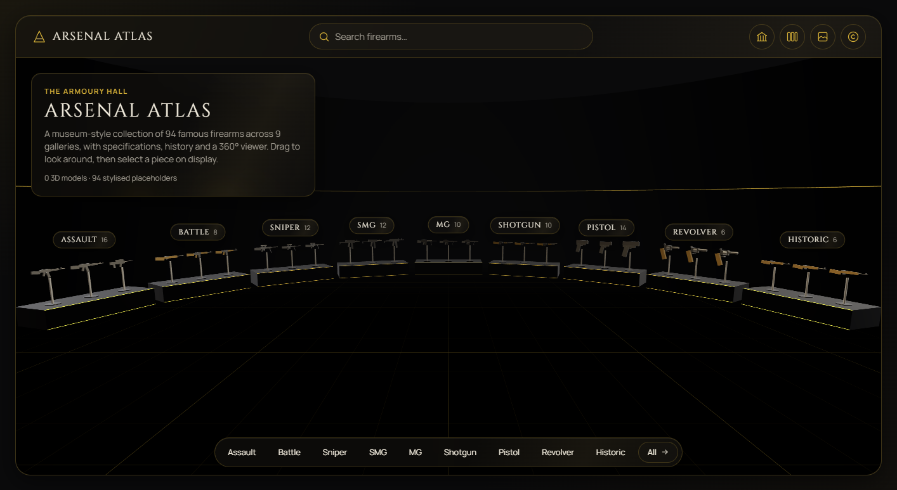
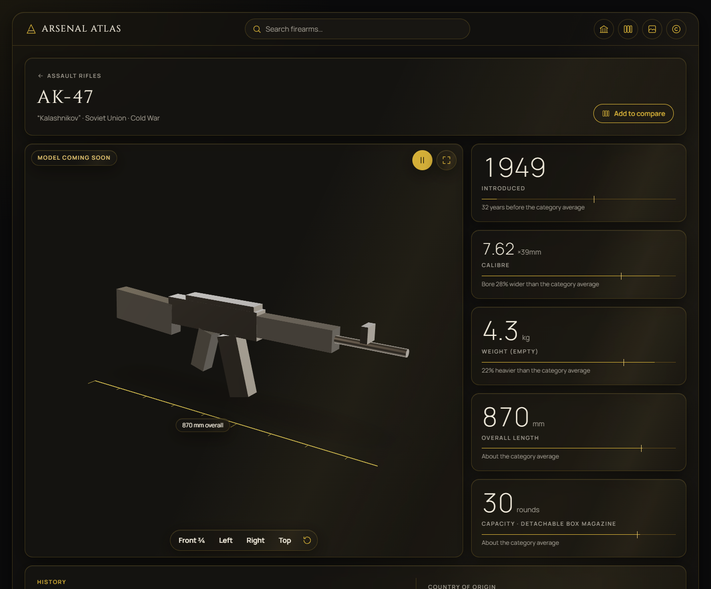
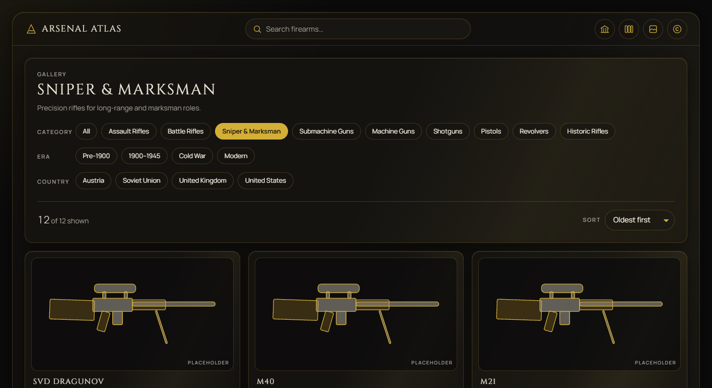
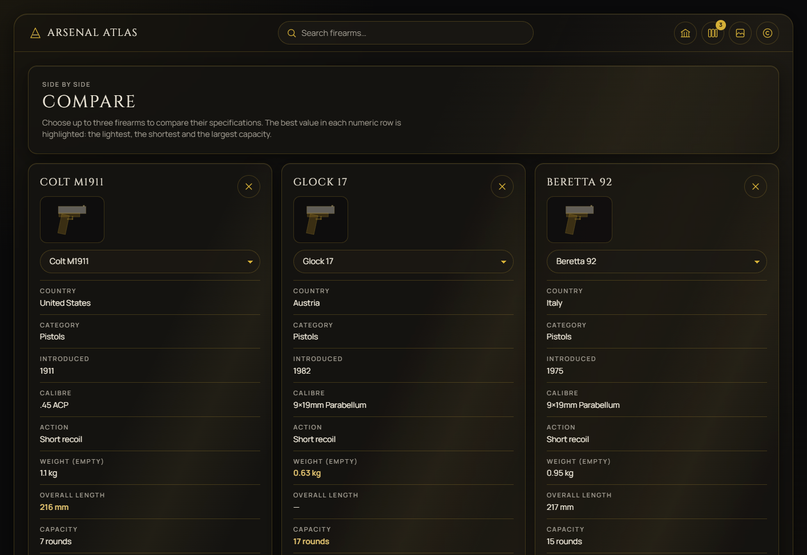
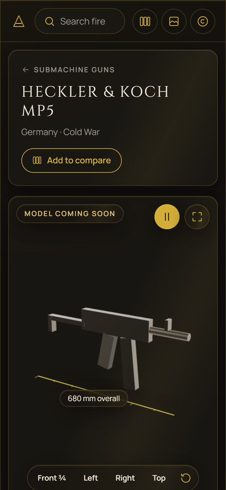

# Arsenal Atlas

**A museum-style 3D atlas of 81 of the world's most famous firearms.** Walk into a dark armoury hall, browse nine galleries, and turn any piece through a full 360° on a turntable, with its specifications, history and service record beside it.

It's built entirely with free tools, has no backend and no API keys, and deploys as a static site on Vercel's free tier.



---

## What you can do

| | |
|---|---|
| **Walk the armoury hall** | The home page is a real-time 3D hall: nine gallery bays on a curved arc, dark brushed-metal plinths with gold edge lighting, warm spotlights, a reflective black floor and a faint gold grid that fades into fog. Hover a piece to see its name; click it to open it. |
| **Inspect any piece in 360°** | Every firearm page has a turntable viewer. Drag to orbit, pinch or scroll to zoom, double-click to reset, or jump to preset views (front ¾, left, right, top). It also has fullscreen, a pause button, and a scale bar under the model showing its real overall length. |
| **Read the spec sheet at a glance** | Introduced year, calibre, weight, length and capacity are shown as large, thin numerals. Each has a gold line comparing it with the gallery average ("22% heavier than the category average"). |
| **See where it sits in history** | A hand-drawn SVG sparkline plots the introduction year of every piece in the same gallery, with the current one highlighted. Click any point to jump to that firearm. |
| **Browse, search, filter, sort** | Gallery pages have search (by name, nickname, country, calibre, maker or conflict), filter chips for gallery, era and country, and sorting by name, year, weight or length. Filters live in the URL, so any view can be shared. |
| **Compare up to three** | Put three firearms side by side with aligned rows. The best value in each numeric row (lightest, shortest, largest capacity) lights up in gold. The comparison is in the URL too. |
| **Works without 3D** | No WebGL? The site switches to a clean 2D mode automatically, and you can also toggle it by hand. Everything stays usable. |



## What makes the experience different

- **It feels like a place, not a list.** You arrive in a hall and walk the galleries before you ever see a grid of cards. The 3D lobby *is* the navigation.
- **One consistent material language.** The whole interface is "Black-Gold Glass": frosted panels floating over near-black, thin gold rules, and a soft diagonal sheen that drifts when you hover. The same palette carries into the 3D scene, from the gold edge strips to the warm spotlights. The palette is six colours, with no blue, green or red anywhere.
- **Numbers with context.** Every figure is set against its gallery average, so "4.3 kg" becomes "22% heavier than its peers" at a glance.
- **Honest data.** Any figure that wasn't certain was left blank (shown as "—") instead of guessed, and every blank is listed in [`data/VERIFY.md`](data/VERIFY.md). All descriptions are original writing.
- **Real scale.** Models and placeholders are scaled to each firearm's real overall length, and the scale bar under the turntable shows it in millimetres.
- **Museum tone.** The content is encyclopedic: origin, era, designers, notable users and history. There are no cutaways, internals, maintenance or modification details, and no violent imagery.
- **Graceful from day one.** The app works with zero 3D models. Every piece has a stylised outline silhouette built from simple primitives, marked "Model coming soon", until a properly licensed model is added.

| Gallery | Compare | Phone |
|---|---|---|
|  |  |  |

## The collection

81 firearms across nine galleries, each with its own 3D model:

| Gallery | Pieces | | Gallery | Pieces |
|---|---|---|---|---|
| Assault rifles | 13 | | Light & general-purpose machine guns | 10 |
| Battle rifles | 7 | | Shotguns | 8 |
| Sniper & marksman rifles | 9 | | Pistols | 13 |
| Submachine guns | 12 | | Revolvers | 4 |
| | | | Historic & classic rifles | 5 |

Each entry has a name, nickname, country, manufacturer, designer, year introduced, calibre, action type, weight, length, capacity, notable users and conflicts, a short history and one or two "did you know" notes. The data is in [`data/firearms.json`](data/firearms.json).

## Built with

- **Vite + React + TypeScript** with React Router
- **three.js** through **@react-three/fiber** and **@react-three/drei** (OrbitControls, contact shadows, reflective floor, HDRI environment)
- **Tailwind CSS** with a strict token theme (the default palette is removed entirely)
- **gltf-transform** for the model compression pipeline (Meshopt geometry, WebP textures)
- A CC0 studio HDRI from Poly Haven, and the Cinzel and Manrope fonts, all self-hosted

### Performance and accessibility

- Every route is code-split. three.js only downloads when you open the lobby or a firearm page, and each model loads only when its page opens.
- The renderer drops its pixel ratio automatically when the frame rate falls, and phones get a lighter blur and a simpler floor.
- Lighthouse (mobile, throttled) on a gallery page: **Performance 92 · Accessibility 100 · Best Practices 100**.
- Full keyboard support: skip link, visible 2px gold focus rings, and keyboard controls in the viewer (arrows rotate, +/- zoom, 0 resets). All text meets WCAG AA contrast on glass (muted text is 6.6:1).
- `prefers-reduced-motion` turns off the turntable and the staggered animations. `prefers-reduced-transparency` swaps frosted glass for solid panels.

### Security

Deployed with a strict Content Security Policy (`'self'` only, with `blob:`/`data:` allowed for images, workers and model buffers that three.js needs, and `'wasm-unsafe-eval'` for the Meshopt and Draco decoders), `frame-ancestors 'none'`, `nosniff`, and a strict referrer policy. See [`vercel.json`](vercel.json). `npm run preview` serves the same headers locally.

## Run it locally

Requires Node.js 20 or newer.

```bash
git clone https://github.com/Aditya-7826/arsenal-atlas.git
cd arsenal-atlas
npm install
npm run dev        # http://localhost:5173
```

| Script | What it does |
|---|---|
| `npm run dev` | Development server with hot reload |
| `npm run build` | Type-check and build to `dist/` |
| `npm run preview` | Serve the production build with production security headers |
| `npm run lint` | Lint with oxlint |
| `npm run models:optimize` | Compress raw models from `models-raw/` into `public/models/` |
| `npm run models:check` | Show which firearms have models, which are placeholders, and which models lack credits |

## Adding 3D models

The site ships with stylised placeholders. To add real models (CC0 or CC BY only, external appearance only):

1. Download a GLB from Sketchfab (Downloadable + Creative Commons filters), Poly Pizza or Poly Haven.
2. Save it as `models-raw/<id>.glb`, for example `models-raw/ak-47.glb`.
3. Run `npm run models:optimize`.
4. Add the attribution to [`data/credits.json`](data/credits.json). It appears on the in-app Credits page automatically.
5. Run `npm run models:check`.

The full guide is in [MODELS.md](MODELS.md).

## Deploy to Vercel (free)

1. Go to [vercel.com/new](https://vercel.com/new) and import this repository.
2. Leave the defaults. Vercel detects Vite, and `vercel.json` already provides the SPA rewrite, security headers and caching rules.
3. Deploy. Every push to `main` redeploys automatically.

## Project structure

```
data/
  firearms.json      the catalogue (81 entries)
  credits.json       attribution for models and other assets
  VERIFY.md          every field left blank on purpose, to verify
public/
  models/            optimised <id>.glb files
  hdri/  fonts/  draco/
scripts/
  optimize-models.mjs
  check-models.mjs
src/
  pages/             Lobby, Category, Firearm, Compare, Credits
  three/             LobbyScene, Viewer, model loading, placeholders
  components/        GlassPanel, StatTile, Sparkline, cards, icons
  silhouette.ts      placeholder outlines (shared by the SVG and 3D views)
```

## Content and credits

All descriptions in this project are original writing based on widely documented public history. Specifications are included only where they're well established; anything uncertain is left blank and listed in `data/VERIFY.md`. Third-party assets (HDRI, fonts, any 3D models) are listed with their licences on the in-app **Credits** page and in `data/credits.json`.

Arsenal Atlas is an educational, museum-style reference. It deliberately contains no maintenance, modification, manufacturing or internal-mechanism information.
